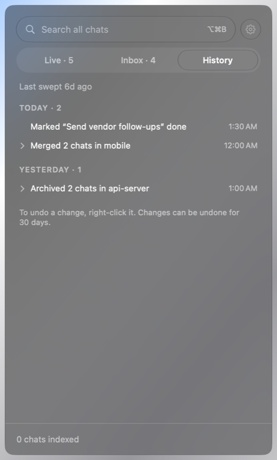

# Broom

[](https://github.com/mvoshell652/broom/actions/workflows/ci.yml) [](LICENSE)

Broom is a macOS menu bar app for people who run several Claude Code sessions at once. Open it and within a second you know which session is waiting on you, what is still running and how far along it is, and what finished while you were looking elsewhere.


## Why

Some Claude Code sessions are long agent loops, others are one quick question. With four or five open in different terminals and in the Claude app, it is hard to tell which one stopped to ask you something, which is still working, and which finished twenty minutes ago. Broom watches all of them and puts the answer in the menu bar: the number of live sessions, with an amber dot when one is waiting on you.

## What it does

**Live** lists sessions in four groups: waiting on you, with the question it asked; running, with the step it is on when it keeps a task list; done since you last looked; and quick chats, which fade after a day. Open chat brings the session's terminal or Claude app window forward, or resumes an ended session in your terminal. Stop sends the session an interrupt after you confirm. Sessions left quiet for hours, and Claude Code processes that belong to no session, collect at the bottom so you can stop them.

**Search** finds any past chat by what you typed or what Claude replied, by words or by meaning. Press ⌥⌘B anywhere, or type in the popover's search field.

**Inbox** raises chats that look like duplicates of each other, chats that ended on a question from Claude or on your own "I'll do this later", and projects whose chats have been quiet for three months. Sweep now goes through them one card at a time.

**History** lists every change you made in the Inbox for 30 days, by day, and undoes any of them.

<p>


</p>

## Install

You need macOS 14 or later, Xcode 26 or later (Broom is built on your Mac, so there is no download to trust), and Claude Code.

```
d=$(mktemp -d) && git clone --depth 1 https://github.com/mvoshell652/broom "$d" && sh "$d/install.sh"
```

The script builds Broom, copies it to `/Applications` (or `~/Applications` if that is not writable) and opens it. The broom appears in the menu bar.

**Connect Claude Code.** Open Broom's settings (the gear in the popover) and choose **Connect Claude Code…**. Broom shows the exact change it will make to `~/.claude/settings.json`, writes a backup next to it first, and leaves your other hooks alone. With hooks connected, a session that is waiting on you shows within two seconds and can notify you. Without them Broom still works from the session transcripts, a little later and without waiting notifications.

**Update:** run the same line again. Your settings, index and history are kept.

**Uninstall:** in Broom's settings choose **Disconnect…**, which takes Broom's hooks out of `settings.json`. Then quit Broom and delete the app and its data:

```
rm -rf /Applications/Broom.app ~/Library/Application\ Support/Broom
```

## Privacy

- Broom makes no network connections. The only listener is on `127.0.0.1`, for the hook helper, with a token stored at mode `0600`.
- It reads Claude Code's transcripts in `~/.claude/projects` and never writes there. The only file it changes under `~/.claude` is `settings.json`, and only after you confirm the change.
- Search uses a copy of what you typed and what Claude replied, kept in `~/Library/Application Support/Broom/index.sqlite` at mode `0600`. Tool input and output are not copied. Settings has **Delete Index**.
- Matching by meaning uses Apple's on-device sentence embeddings. No API key and no model download.

## How it works

Claude Code runs a small helper, `broom-hook`, for each hook event: a session starting, a prompt, a tool call, a permission request, a stop. The helper forwards the event to Broom and exits within 300 ms whether or not Broom is running, writing nothing to the terminal. Broom turns the events into each session's state, reads the transcript for the title and the task list, and checks that the session's process is still alive. Sessions with no hooks have their state inferred from the transcript alone.

Archiving and merging only change how Broom shows your chats.

## Keys

| Where | Key | Does |
|---|---|---|
| Anywhere | ⌥⌘B | Opens search |
| Popover | ↑ ↓ | Moves between sessions |
| Popover | Return | Opens the selected session |
| Popover | ⌘. | Stops the selected session, after you confirm |
| Sweep | ← → E | Skip, do the card's action, edit it |

## Develop

```
swift test
swift build && .build/debug/Broom --preview
scripts/make-app.sh
```

`--preview` opens the popover with sample data in a window; add `--tab inbox` or `--tab history`, `--dark`, or `--deck` for the sweep. `--render <folder>` writes PNGs of every screen. These environment variables point Broom somewhere other than your real data, so experiments never touch it:

| Variable | Replaces |
|---|---|
| `BROOM_PROJECTS_DIR` | `~/.claude/projects` |
| `BROOM_SETTINGS_FILE` | `~/.claude/settings.json` |
| `BROOM_SUPPORT_DIR` | `~/Library/Application Support/Broom` |
| `BROOM_DATABASE`, `BROOM_INDEX`, `BROOM_WORKSTREAMS` | The session, search and organiser databases in it |
| `BROOM_HOOK_PORT` | Port 47811 |
| `BROOM_NO_NOTIFICATIONS` | Set to `1` to post none |

See [CONTRIBUTING.md](CONTRIBUTING.md) before opening a pull request.

## Status

Broom is early, version 0.1. It follows Claude Code sessions only; chats on claude.ai are not read. It is built from source because the project has no Developer ID certificate to notarize a download.

## License

MIT. See [LICENSE](LICENSE).
