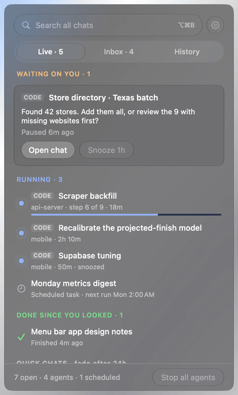
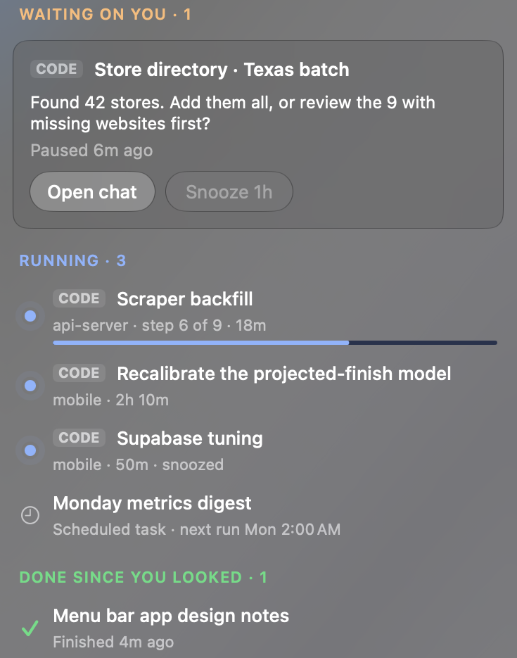
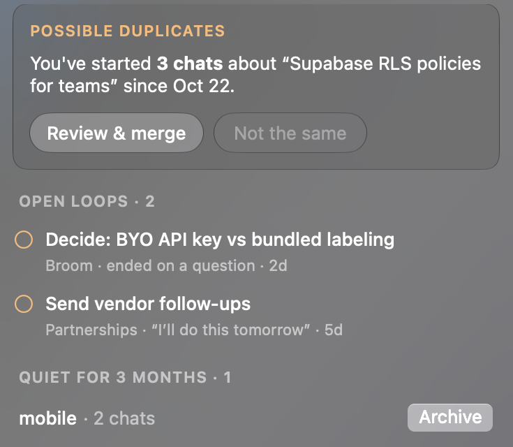
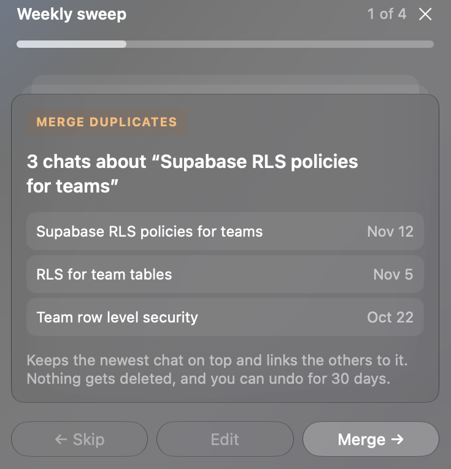
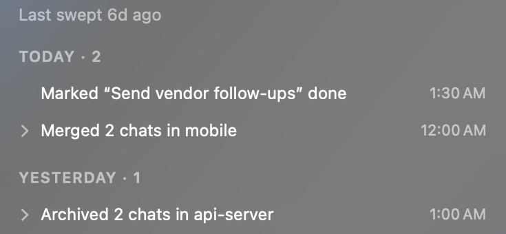
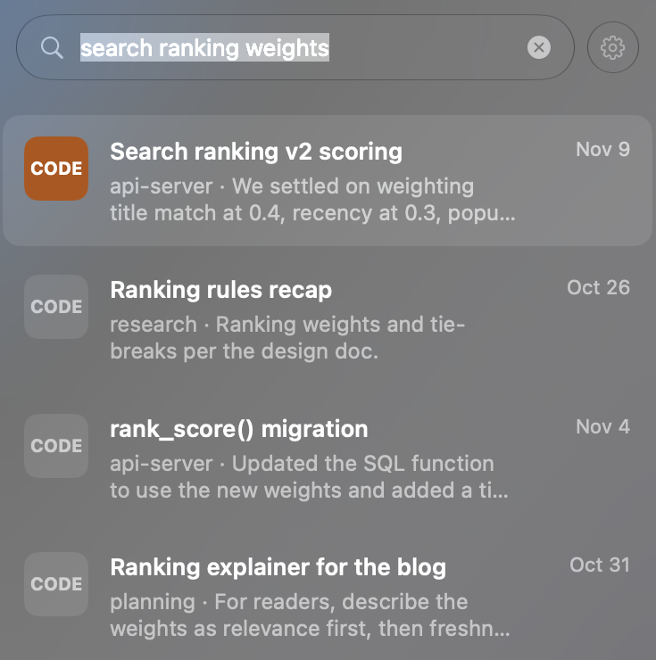

# Broom

[](https://github.com/mvoshell652/broom/actions/workflows/ci.yml) [](LICENSE) 

**Know which Claude Code session needs you, from the menu bar.**

Broom shows which of your open Claude Code sessions is waiting on you, which are still working and which have finished, and takes you straight to the one that needs you. It also helps you tidy the chats piling up behind them.



```
d=$(mktemp -d) && git clone --depth 1 https://github.com/mvoshell652/broom "$d" && sh "$d/install.sh"
```

Free and open source.

## Where it came from

Broom started in a LinkedIn thread. A product designer wished Claude had a "clean up time": a way to sort stray chats and catch the ones she had started more than once. A design leader added the other half. With four to six chats open, he kept losing track of which were long-running agent loops and which were quick questions. I had both problems, so I said I would build something.

Those two complaints became Broom's two halves: **Live** for the sessions open right now, and the **Inbox** for everything before them.

## A tour

Broom lives in the menu bar. Click the broom and a popover opens with a search field and three tabs: Live, Inbox and History.

### The menu bar

The broom shows how many sessions are running, and gets an amber dot when one is waiting on you. That is usually all you need to see: no dot, nothing needs you.


### Live: the sessions open right now

Every Claude Code session on your Mac, from any terminal, your editor or the Claude desktop app, sorted by what it needs from you:



- **Waiting on you.** The session stopped to ask for a permission or an answer. The card shows what it asked and how long ago. **Open chat** jumps to it; **Snooze 1h** moves it out of the way and keeps it quiet.
- **Running.** Each session shows its project and how long it has been working. When Claude keeps a task list, you also see "step 6 of 9" and a progress bar.
- **Done since you looked.** Sessions that finished while you were away. They leave this section once you have seen them.
- **Quick chats.** One question, no tools. They fade after a day, so they never crowd out real work.
- **Quiet, still open** and **Claude Code with no session.** Sessions idle for two hours whose process is still alive, and Claude Code processes that belong to no session at all, each with **Stop**.

The footer counts what is open, and **Stop all agents** interrupts every running or waiting session after you confirm. Stopping sends the same interrupt as pressing Control-C in the session, never a force quit.

### Inbox: the chats behind them

Broom reads your past Claude Code chats and raises the few worth a decision:



- **Possible duplicates.** Chats from the last 30 days that open with the same prompt, or a very similar one. **Review & merge** lists them and folds them into one row, newest on top. **Not the same** stops Broom raising them together again.
- **Open loops.** Chats that ended on a question from Claude, or on your own "I'll do this later", and have been quiet for a day or more. Tick the circle when it is done; it comes back if the chat picks up again.
- **Quiet for 3 months.** Projects whose chats nobody has touched in 90 days, with **Archive** to take them out of the Inbox. Search still finds them.

**Sweep now** goes through the same items one card at a time, like a weekly review: merge, archive or reopen, or skip a card until next week.



### History

Every merge, archive and "done" from the last 30 days, grouped by day, saying what changed and where. Open a row to see the chats it touched; right-click it to undo.



### Search

Press ⌥⌘B anywhere, or type in the popover's search field, to find any past chat by what you typed or what Claude replied. It matches the words, and the meaning when you remember the idea but not the words. Open a result to resume the chat, or copy the command that resumes it.



### Notifications and settings

Broom notifies you when a session is waiting on you, with **Open** and **Snooze 1h** on the notification. It can notify you when a session finishes too; that one is off until you turn it on. Settings also has opening at login, which terminal ended sessions reopen in, the Claude Code connection, and your search index.

## Install

You need macOS 14 or later, [Xcode](https://apps.apple.com/app/xcode/id497799835) 26 or later, and Claude Code. Run the line above. It builds Broom on your Mac, copies it to `/Applications` (or `~/Applications` when that is not writable) and opens it.

Then connect Claude Code, so a waiting session shows right away and can notify you:

1. Click the broom in the menu bar, then the gear.
2. Choose **Connect Claude Code…**.
3. Read the change Broom will make to `~/.claude/settings.json` and confirm. Broom saves a backup next to the file first and leaves your other hooks alone.

Broom works without this step too, from the session transcripts, a little slower and without waiting notifications.

**Update:** run the install line again. Your settings, search index and history are kept.

**Uninstall:** choose **Disconnect…** in Broom's settings to take its hooks out of `settings.json`, quit Broom, then:

```
rm -rf /Applications/Broom.app ~/Library/Application\ Support/Broom
```

## Questions

**Does anything leave my Mac?** No. Broom makes no network connections. Search runs on a local copy of what you typed and what Claude replied, at mode `0600` in `~/Library/Application Support/Broom`, without tool input or output, and matching by meaning uses Apple's on-device sentence embeddings. **Delete Index** in settings removes the copy.

**Will it touch my Claude Code files?** It reads the transcripts in `~/.claude/projects` and never writes there. The only file it changes is `settings.json`, and only after you confirm the diff. Merging and archiving change how Broom shows your chats, not the chats.

**Which terminals does Open chat work with?** A running session is brought forward in whatever app it runs in, including the Claude desktop app. To reopen an ended session, Broom uses Terminal, iTerm, Ghostty, Warp, Visual Studio Code or Cursor; pick one in settings.

**Does it see chats on claude.ai?** Not yet. Broom follows Claude Code sessions only.

**Why build from source instead of downloading an app?** The project has no Apple Developer ID yet, so a downloaded app could not be notarized and macOS would warn on every install. Building on your own Mac avoids that.

**How heavy is it?** Measured with 23 sessions tracked: under 1% CPU when idle and under 70 MB of memory.

## How it works

Claude Code runs a small helper, `broom-hook`, for each hook event: a session starting, a prompt, a tool call, a permission request, a stop. The helper passes the event to Broom over `127.0.0.1` with a private token, then exits within 300 ms whether or not Broom is running, and never prints to your terminal. Broom turns the events into each session's state, reads the transcript for the title and the task list, and checks that the session's process is still alive. A session without hooks has its state worked out from the transcript alone.

## Keys

| Where | Key | Does |
|---|---|---|
| Anywhere | ⌥⌘B | Opens search |
| Popover | ↑ ↓ | Moves between sessions |
| Popover | Return | Opens the selected session |
| Popover | ⌘. | Stops the selected session, after you confirm |
| Sweep | ← → E | Skips a card, does its action, edits it |

## Develop

```
swift test
swift build && .build/debug/Broom --preview
scripts/make-app.sh
```

`--preview` opens the popover with sample data in a window; add `--tab inbox` or `--tab history`, `--dark`, or `--deck` for the sweep. `--render <folder>` writes PNGs of every screen. These variables point Broom away from your real data, so experiments never touch it:

| Variable | Replaces |
|---|---|
| `BROOM_PROJECTS_DIR` | `~/.claude/projects` |
| `BROOM_SETTINGS_FILE` | `~/.claude/settings.json` |
| `BROOM_SUPPORT_DIR` | `~/Library/Application Support/Broom` |
| `BROOM_DATABASE`, `BROOM_INDEX`, `BROOM_WORKSTREAMS` | The session, search and organiser databases in it |
| `BROOM_HOOK_PORT` | Port 47811 |
| `BROOM_NO_NOTIFICATIONS` | Set to `1` to post none |

Read [CONTRIBUTING.md](CONTRIBUTING.md) before opening a pull request, and report security problems privately as [SECURITY.md](SECURITY.md) describes.

## Status

Version 0.1, early. Bug reports and ideas are welcome in [Issues](https://github.com/mvoshell652/broom/issues).

## License

MIT. See [LICENSE](LICENSE).
