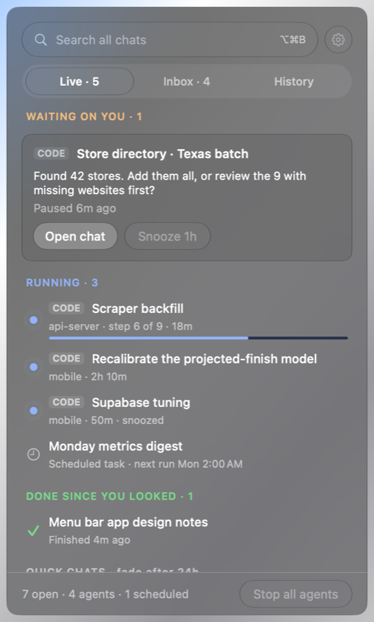
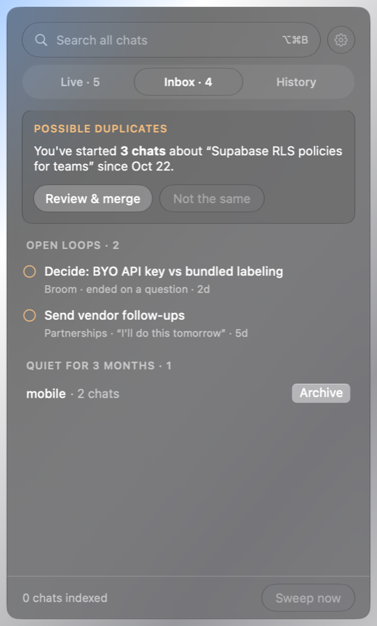

# Broom

[](https://github.com/mvoshell652/broom/actions/workflows/ci.yml) [](LICENSE) 

**Know which Claude Code session needs you, from the menu bar.**

You have five Claude Code sessions open. One stopped ten minutes ago to ask a question, one finished while you were in a meeting, and three are still working. Broom tells you which is which in one glance, and takes you straight to the one that is waiting.



```
d=$(mktemp -d) && git clone --depth 1 https://github.com/mvoshell652/broom "$d" && sh "$d/install.sh"
```

Free and open source.

## What you get

**A count in the menu bar, and an amber dot when a session is waiting.** You stop checking terminals to see whether anything needs you.

**The question, not just the alert.** A waiting session shows what it asked, so you can decide before you switch. **Open chat** brings its terminal or Claude app window to the front. A session that has ended reopens in your terminal.

**Progress you can read.** A running session shows its project, how long it has run, and "step 6 of 9" with a bar when it keeps a task list.

**What finished while you were away.** Done sessions wait in their own section until you have looked. Quick one-question chats fade after a day.

**A clean stop.** Stop interrupts a session after you confirm. Sessions left idle for hours, and Claude Code processes that belong to no session, gather at the bottom so you can close them.

**Every past chat, searchable.** Press ⌥⌘B anywhere and find a chat by what you typed or what Claude replied, even when you remember the idea but not the words.

**A tidy history.** The Inbox points out chats you started twice, chats you left on a question or a "later", and projects that have gone quiet. Merge, mark done or archive in a click, and undo anything from History for 30 days.

<p>


</p>

## Install

You need macOS 14 or later, [Xcode](https://apps.apple.com/app/xcode/id497799835) 26 or later, and Claude Code. Run the line above. It builds Broom on your Mac, copies it to `/Applications` (or `~/Applications` when that is not writable) and opens it.

Then connect Claude Code, so a waiting session shows right away and can notify you:

1. Click the broom in the menu bar, then the gear.
2. Choose **Connect Claude Code…**.
3. Read the change Broom will make to `~/.claude/settings.json` and confirm. Broom saves a backup next to the file first and leaves your other hooks alone.

Broom works without this step too, from the session transcripts, a little slower and without waiting notifications.

**Update:** run the install line again. Your settings, search index and history are kept.

**Uninstall:** choose **Disconnect…** in Broom's settings to take its hooks out of `settings.json`, quit Broom, then:

```
rm -rf /Applications/Broom.app ~/Library/Application\ Support/Broom
```

## Questions

**Does anything leave my Mac?** No. Broom makes no network connections. Search runs on a local copy of what you typed and what Claude replied, at mode `0600` in `~/Library/Application Support/Broom`, without tool input or output, and matching by meaning uses Apple's on-device sentence embeddings. **Delete Index** in settings removes the copy.

**Will it touch my Claude Code files?** It reads the transcripts in `~/.claude/projects` and never writes there. The only file it changes is `settings.json`, and only after you confirm the diff. Merging and archiving change how Broom shows your chats, not the chats.

**Which terminals does Open chat work with?** A running session is brought forward in whatever app it runs in, including the Claude desktop app. To reopen an ended session, Broom uses Terminal, iTerm, Ghostty, Warp, Visual Studio Code or Cursor; pick one in settings.

**Does it see chats on claude.ai?** Not yet. Broom follows Claude Code sessions only.

**Why build from source instead of downloading an app?** The project has no Apple Developer ID yet, so a downloaded app could not be notarized and macOS would warn on every install. Building on your own Mac avoids that.

**How heavy is it?** Measured with 23 sessions tracked: under 1% CPU when idle and under 70 MB of memory.

## How it works

Claude Code runs a small helper, `broom-hook`, for each hook event: a session starting, a prompt, a tool call, a permission request, a stop. The helper passes the event to Broom over `127.0.0.1` with a private token, then exits within 300 ms whether or not Broom is running, and never prints to your terminal. Broom turns the events into each session's state, reads the transcript for the title and the task list, and checks that the session's process is still alive. A session without hooks has its state worked out from the transcript alone.

## Keys

| Where | Key | Does |
|---|---|---|
| Anywhere | ⌥⌘B | Opens search |
| Popover | ↑ ↓ | Moves between sessions |
| Popover | Return | Opens the selected session |
| Popover | ⌘. | Stops the selected session, after you confirm |
| Sweep | ← → E | Skips a card, does its action, edits it |

## Develop

```
swift test
swift build && .build/debug/Broom --preview
scripts/make-app.sh
```

`--preview` opens the popover with sample data in a window; add `--tab inbox` or `--tab history`, `--dark`, or `--deck` for the sweep. `--render <folder>` writes PNGs of every screen. These variables point Broom away from your real data, so experiments never touch it:

| Variable | Replaces |
|---|---|
| `BROOM_PROJECTS_DIR` | `~/.claude/projects` |
| `BROOM_SETTINGS_FILE` | `~/.claude/settings.json` |
| `BROOM_SUPPORT_DIR` | `~/Library/Application Support/Broom` |
| `BROOM_DATABASE`, `BROOM_INDEX`, `BROOM_WORKSTREAMS` | The session, search and organiser databases in it |
| `BROOM_HOOK_PORT` | Port 47811 |
| `BROOM_NO_NOTIFICATIONS` | Set to `1` to post none |

Read [CONTRIBUTING.md](CONTRIBUTING.md) before opening a pull request, and report security problems privately as [SECURITY.md](SECURITY.md) describes.

## Status

Version 0.1, early. Bug reports and ideas are welcome in [Issues](https://github.com/mvoshell652/broom/issues).

## License

MIT. See [LICENSE](LICENSE).
